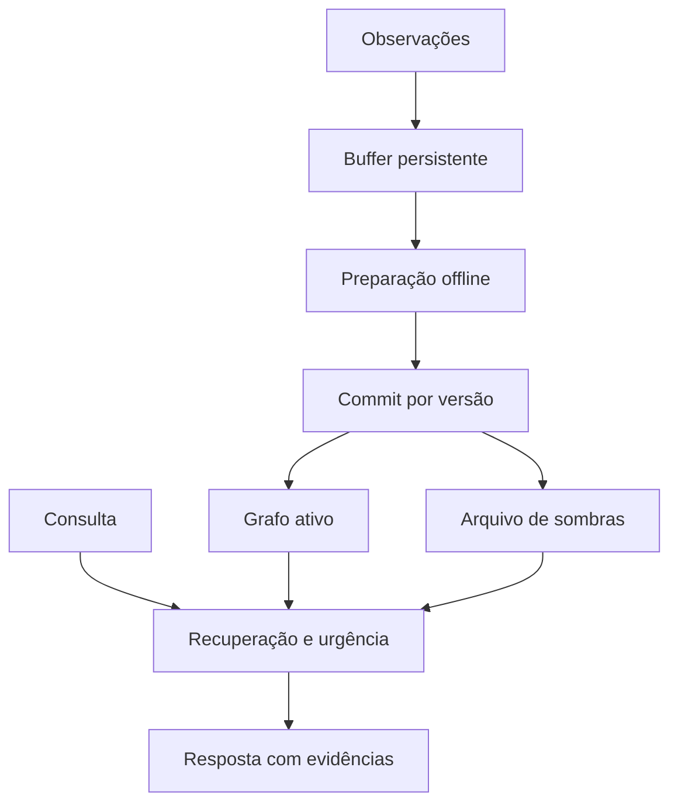

# Arquitetura operacional

## Fluxo de dados



## Concorrência Alpha Omega

Alpha é o papel de atendimento: recebe registros e consulta uma versão publicada.
Omega é o papel de preparação: captura versão V e sequência N, prepara um
candidato fora da transação e só depois tenta publicá-lo.

No commit SQLite:

1. Inicia `BEGIN IMMEDIATE`.
2. Confere se a versão ainda é V.
3. Substitui o acervo ativo/latente e os pendentes até N.
4. Mantém pendentes com sequência maior que N, inclusive os recebidos durante o sono.
5. Atualiza arestas, propostas, versão e referência de adaptador na mesma transação.
6. Confirma a transação. Falha ou versão divergente impede a publicação.

É uma implementação local de compare-and-swap. Não é um cluster Kafka nem uma
prova de consistência distribuída. Leituras, escrita e publicação usam bloqueios
curtos locais. A preparação lenta não mantém o bloqueio do banco. O teste de
concorrência bloqueia propositalmente um replay, observa e consulta durante o
intervalo, e confirma que a observação tardia continua pendente após o commit.

Outro teste usa dois Engines no mesmo arquivo e verifica que um candidato
obsoleto não sobrescreve uma promoção publicada pelo outro.

## Adaptadores e disponibilidade

O replay cria um diretório novo. Até o commit, o estado publicado continua
apontando para o adaptador anterior. Falhas podem deixar diretórios candidatos
órfãos; eles não são ativados automaticamente. O código não remove arquivos
de adaptador por conta própria.

O backend Transformers carrega a versão de adaptador indicada pela consulta.
Recarga é serializada e pode consumir tempo e memória adicionais. Isso não
oferece garantia de zero downtime, nem de operação simultânea de duas cópias
grandes em qualquer hardware. Inferência externa via Ollama não recebe esses
adaptadores automaticamente.

## Persistência e limites

- SQLite armazena registros, vetores float32, arestas, eventos e propostas.
- Eventos e propostas são limitados e não incluem automaticamente texto bruto.
- O limite de texto mede bytes UTF-8 do campo text, não todos os bytes do banco.
- Vetores, metadados, índices e páginas WAL têm custo adicional reportável.
- Buffer pendente cheio rejeita novas entradas até consolidação ou remoção.
- Capacidade de registros ativos e sombras é finita; memória útil pode ser perdida.
- `direction_only` remove text e metadados do estado atual das sombras. Referência
  source, ID, campos escalares e vetor continuam presentes. Não há garantia de
  exclusão física de todo histórico, WAL ou backups, nem de unlearning paramétrico.

Use backup SQLite consistente. Para preservar uma execução com replay, inclua os
diretórios externos de adaptadores e os identificadores de revisão dos modelos.

## Serviço local

`serve` usa ThreadingHTTPServer. A interface não depende de CDN. O padrão é
127.0.0.1 e o token opcional vem de LLICAMS_API_TOKEN. Bind fora de loopback exige
token. A aplicação não foi desenvolvida como serviço público multiusuário.
Não há execução de comandos recebidos de memória ou da resposta de um LLM.

Consolidação periódica é opt-in:

```bash
llicams --db pesquisa.sqlite serve --sleep-interval 30
```

O agendador verifica pendentes e reutiliza um job existente em vez de enfileirar
sono indefinidamente. A preparação pode ocorrer enquanto o atendimento continua.
“Offline” significa fora da requisição corrente, não necessariamente máquina ou
agente globalmente inativo.
